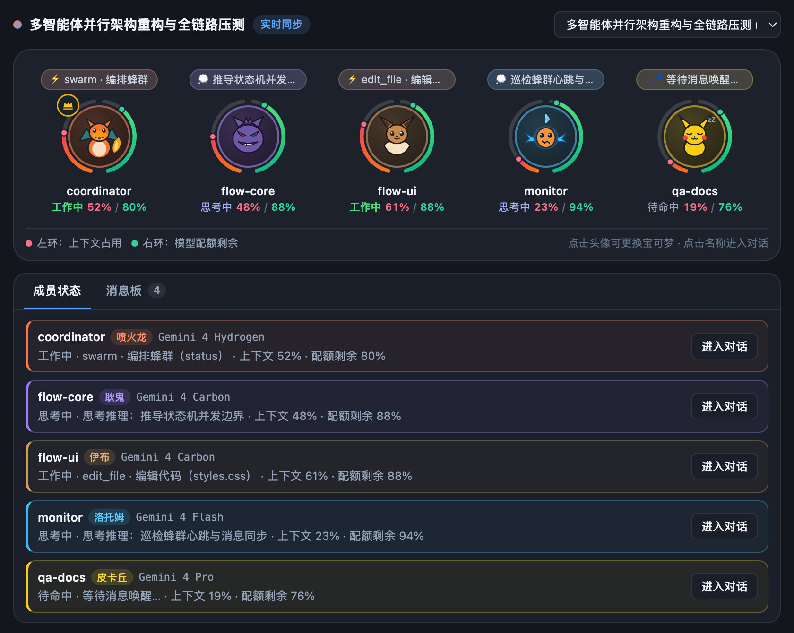
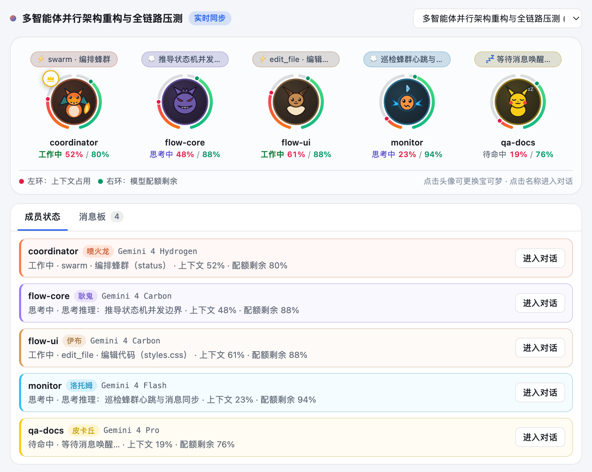
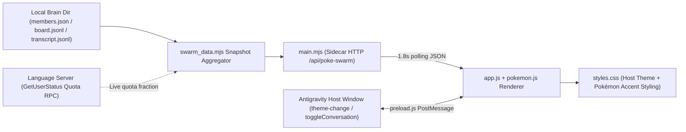

<div align="center">


# Poke Swarm HUD

**A Pokémon-Inspired Real-Time Swarm Monitoring HUD Sidecar for Google Antigravity**

[](README.md)
[](README.en.md)

[](LICENSE)
[](#installation--usage)
[](#tech-stack--structure)
[](#development--testing)

[Screenshots](#screenshots) · [Key Features](#key-features) · [Metrics & Status](#metrics--member-status-reference) · [Role Matching](#automatic-pok%C3%A9mon-role-matching) · [Installation](#installation--usage) · [Architecture](#architecture--data-flow) · [Testing](#development--testing)

<br />

<picture>
  <source media="(prefers-color-scheme: dark)" srcset="assets/preview-dark.png" />
  <source media="(prefers-color-scheme: light)" srcset="assets/preview-light.png" />
  
</picture>

</div>

---

## Screenshots

Poke Swarm HUD automatically adapts its entire palette to the host IDE theme and custom color tokens. Below are 2x Retina captures in Dark Mode and Light Mode:

<table>
  <tr>
    <th width="50%">Dark Mode</th>
    <th width="50%">Light Mode (Auto-Adapted)</th>
  </tr>
  <tr>
    <td></td>
    <td></td>
  </tr>
</table>

---

## Key Features

- **10 Crisp Inline SVG Pokémon Avatars**
  Hand-crafted inline vector SVGs with zero external CDN dependencies. Click any avatar to open the skin picker popover and customize that agent's Pokémon locally; the `coordinator` automatically wears a golden crown badge.

- **Dual-Ring Health Telemetry**
  Dual concentric arc gauges frame each avatar to display **Context Window Usage** (left arc) and **Model Remaining Quota / Board Sync** (right arc) at a glance without leaving your active workspace.

- **Incremental Live Activity Bubbles**
  Reads member `transcript.jsonl` files using `mtime/size`-keyed caching to surface the active tool call (e.g., `swarm`, `edit_file`) or latest reasoning headline right above each avatar.

- **Dual Theme Adaptation (Host Skin + Pokémon Accent)**
  - **Host IDE Theme Sync**: Listens to Antigravity's `theme-change` CSS custom properties (`--background`, `--card`, `--secondary`, `--foreground`, `--primary`, etc.) and updates `data-theme` and `color-scheme` from computed background luminance.
  - **Per-Pokémon Accent Harmony**: Member cards, hover glows, activity pills, and detail row borders automatically inherit each avatar's `--poke-accent` token while keeping the dual-ring telemetry colors unambiguous.

- **Clean Single-Row HUD & One-Click Navigation**
  Keeps members aligned in a compact single-row strip with hidden scrollbars, smooth horizontal mouse-wheel scrolling, and edge fade affordance hints. Click any member name or detail row button to jump directly to its subagent conversation, or switch between historical local Swarms from the header selector.

---

## Metrics & Member Status Reference

### 1. Dual-Ring Telemetry Calculation

| Arc | Palette | Meaning | Data Source & Fallback |
| :--- | :---: | :--- | :--- |
| **Left Arc** | Orange → Rose (`#f97316` → `#f43f5e`) | Context Window Usage | Computed from `input_tokens + cache_read_tokens + output_tokens` in the member's latest `PLANNER_RESPONSE` against a `1M` token context budget |
| **Right Arc** | Emerald (`#10b981` → `#4ade80`) | Remaining Quota / Sync | Queries local Language Server `GetUserStatus` for live `remainingFraction` per model; falls back gracefully to `last_read_seq / head` board sync percentage when offline |

### 2. Member Lifecycle States

| Status | Bubble Icon | Visual Feedback | Trigger Condition |
| :--- | :---: | :--- | :--- |
| **Working** | `⚡` | Gentle floating bob animation | Active tool call other than `swarm_wait` in current turn |
| **Thinking** | `💭` | Floating animation + soft icon pulse | Reasoning in progress or awaiting intermediate output |
| **Waiting** | `💤` | Closed-eye resting face + `zZ` badge | `swarm_wait` completed or turn ended awaiting mentions |
| **Ended** | `✓` | Desaturated muted avatar | Marked `killed: true` in `members.json` |
| **Quota / Error** | `⚠` | Amber warning highlight | Recent `429` capacity exhaustion or settled step error |

---

## Automatic Pokémon Role Matching

Agents are assigned a default Pokémon by matching role keywords in their roster name, falling back to a deterministic name hash for unmatched workers (overridable anytime by clicking an avatar):

| Pokémon | Accent Color | Name Pattern Regex (Case-Insensitive) | Typical Swarm Role |
| :--- | :---: | :--- | :--- |
| **Charizard** | `#ff7a45` | `coordinator` \| `lead` \| `master` \| `chief` \| `queen` | Swarm coordinator (with golden crown) |
| **Rotom** | `#38bdf8` | `monitor` \| `watch` \| `guard` \| `health` | Heartbeat & stall monitor |
| **Eevee** | `#d89b56` | `ui` \| `front` \| `web` \| `css` \| `view` \| `design` | Frontend UI, CSS & visual layout |
| **Gengar** | `#9d7aff` | `core` \| `back` \| `api` \| `server` \| `parser` \| `engine` \| `rust` \| `go` | Core engine, backend APIs & parsers |
| **Pikachu** | `#facc15` | `doc` \| `readme` \| `test` \| `verify` \| `verifier` \| `qa` \| `check` | Tests, verification & documentation |
| **Bulbasaur** | `#34d399` | `narrator` \| `summary` \| `overview` | Progress summaries & narration |
| **Squirtle** | `#60a5fa` | `build` \| `infra` \| `cli` \| `script` \| `ops` \| `db` \| `sql` | Build tooling, infra, CLI & databases |
| **Lucario** | `#3b82f6` | `ml` \| `ai` \| `model` \| `data` | ML pipelines & data processing |
| **Jigglypuff** | `#f472b6` | Deterministic hash fallback / manual picker | General worker agent |
| **Snorlax** | `#5eead4` | Deterministic hash fallback / manual picker | General worker agent |

---

## Installation & Usage

### 1. Clone into Antigravity Global Plugins Directory

```bash
git clone https://github.com/xialeizhou77/antigravity-poke-swarm.git ~/.gemini/config/plugins/poke-swarm
```

Once placed under `~/.gemini/config/plugins/poke-swarm`, Antigravity automatically discovers and enables the plugin across all workspaces.

> [!TIP]
> To update later, run `git pull` inside `~/.gemini/config/plugins/poke-swarm`, then toggle **Poke Swarm HUD** off and back on under **Customizations → Plugins** to reload the Sidecar backend.

### 2. Opening the HUD

1. **Aux Pane Tab (Recommended)**: Click `+` in Antigravity's right-hand Auxiliary Pane header and select **Poke Swarm** to pin it side-by-side with your workspace.
2. **Natural-Language Skill Trigger**: Ask the agent in chat (e.g., *"Open the Poke Swarm HUD"* or *"打开宝可梦蜂群看板"*) to trigger the bundled `poke-swarm` skill, which surfaces a one-click `sidecar://` launch pill.

---

## Architecture & Data Flow



---

## Tech Stack & Structure

Built with **zero third-party npm runtime dependencies**, relying solely on Node.js native ESM, standard Web Platform APIs, and Antigravity `sidecar_sdk`:

```text
poke-swarm/
├── plugin.json                      # Antigravity plugin manifest
├── README.md                        # Chinese README (linked to English)
├── README.en.md                     # English README (linked to Chinese)
├── LICENSE                          # MIT License
├── .gitignore
├── assets/
│   ├── logo.svg                     # Plugin vector icon
│   ├── preview-dark.png             # 2x Retina dark theme screenshot
│   └── preview-light.png            # 2x Retina light theme screenshot
├── skills/
│   └── poke-swarm/
│       └── SKILL.md                 # Natural-language HUD launcher skill
└── sidecars/
    └── poke_swarm/
        ├── sidecar.json             # Sidecar process & Aux Pane view config
        ├── package.json             # Package metadata & test script
        ├── main.mjs                 # Sidecar HTTP server (CORS + static & API routes)
        ├── swarm_data.mjs           # Swarm roster, board, transcript & quota aggregator
        ├── swarm_data.test.mjs      # Unit tests via node:test
        ├── pokemon.js               # 10 inline SVG Pokémon renderers & role matcher
        ├── index.html               # HUD document structure
        ├── styles.css               # Theme-adaptive styles, dual rings & edge fades
        └── app.js                   # Polling, host theme sync, skin picker & navigation
```

---

## Development & Testing

Run the automated test suite and syntax checks from the sidecar directory:

```bash
cd sidecars/poke_swarm
npm test
node --check main.mjs && node --check app.js && node --check pokemon.js && node --check swarm_data.mjs
```

---

## License

Released under the [MIT License](LICENSE). Issues and Pull Requests for additional Pokémon sprites or telemetry enhancements are welcome.
