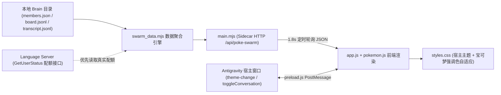

<div align="center">


# Poke Swarm HUD

**宝可梦风格的 Google Antigravity 蜂群（Swarm）实时监控看板插件**

[](LICENSE)
[](#安装与启用)
[](#技术栈与目录结构)
[](#本地开发与测试)

直观呈现 Swarm 多智能体协作阵型、宝可梦角色化身、上下文与配额双色进度环、实时工具调用气泡及消息板动态。

</div>

---

## 界面预览

### 深色主题（Dark Mode）

<p align="center">
  
</p>

### 浅色主题（Light Mode 皮肤自动适配）

<details open>
<summary>点击折叠 / 展开浅色皮肤自适应预览</summary>

<p align="center">
  
</p>

</details>

---

## 核心特性

- **10 款纯内联矢量 SVG 宝可梦化身**
  所有宝可梦均采用高清内联 SVG 绘制，零外网 CDN 依赖。支持**工作中 / 思考中**柔和微动效与**待命中**闭眼 `zZ` 休息态，**已结束**成员自动置灰标记；Coordinator 左上角佩戴金色皇冠徽章。点击任意头像即可弹出选择器自定义更换宝可梦并持久化记忆。

- **双色环形关键指标（上下文 + 配额 / 同步率）**
  - **左环（橙红渐变）**：读取成员 `transcript.jsonl` 最新模型响应的 `input_tokens + cache_read_tokens + output_tokens`，实时估算上下文窗口占用百分比。
  - **右环（翠绿渐变）**：优先连接本地 Antigravity Language Server `GetUserStatus` 获取对应模型的真实剩余配额百分比；在未连接本地服务时自动回退为消息板（`board.jsonl`）同步进度。

- **实时动作与思考推理气泡**
  基于文件 `mtime/size` 缓存高效解析成员执行日志，在头像上方以胶囊气泡展示当前工具调用语义（如 `swarm · 编排蜂群`、`edit_file · 编辑代码`）或最新思考推理标题。

- **宿主皮肤与宝可梦主色双重自适应**
  - **宿主主题自适应**：同步 Antigravity 通过 `theme-change` 注入的 CSS 变量（`--background`、`--card`、`--secondary`、`--foreground`、`--primary` 等），并依据真实背景亮度切换 `data-theme` 与 `color-scheme`。
  - **宝可梦主色联动**：每名成员卡片、气泡微光、详情徽章与左侧边框高亮自动绑定所选宝可梦的 `--poke-accent` 主色，同时保持双环本身「上下文 / 配额」的色彩语义清晰。

- **单行紧凑 HUD 与会话一键直达**
  成员较多时保持单行横向紧凑排布，隐藏底部冗余滚动条并提供鼠标滚轮横向滑动与左右边缘柔和渐隐提示；点击成员名称或详情行中的「进入对话」即可切换至对应子智能体会话，也可在右上角下拉框切换查看本机其它历史 Swarm。

---

## 宝可梦角色自动匹配规则

系统依据成员名称自动匹配最贴合的宝可梦形象；未命中关键词时将按成员名稳定哈希分配其余角色（可随时点击头像手动切换覆盖）：

| 宝可梦 | 专属强调色 | 默认匹配成员命名关键词（正则） | 常见职责定位 |
| :--- | :---: | :--- | :--- |
| **喷火龙** `Charizard` | `#ff7a45` | `coordinator` \| `lead` \| `master` \| `chief` \| `queen` | 总控协调者（配金色皇冠） |
| **洛托姆** `Rotom` | `#38bdf8` | `monitor` \| `watch` \| `guard` \| `health` | 心跳巡检与状态监控 |
| **伊布** `Eevee` | `#d89b56` | `ui` \| `front` \| `web` \| `css` \| `view` \| `design` | 前端页面、样式与交互设计 |
| **耿鬼** `Gengar` | `#9d7aff` | `core` \| `back` \| `api` \| `server` \| `parser` \| `engine` \| `rust` \| `go` | 核心引擎、后端接口与解析器 |
| **皮卡丘** `Pikachu` | `#facc15` | `doc` \| `readme` \| `test` \| `verify` \| `verifier` \| `qa` \| `check` | 测试验证、质量门禁与文档 |
| **妙蛙种子** `Bulbasaur` | `#34d399` | `narrator` \| `summary` \| `overview` | 进度汇总与解说叙事 |
| **杰尼龟** `Squirtle` | `#60a5fa` | `build` \| `infra` \| `cli` \| `script` \| `ops` \| `db` \| `sql` | 构建脚本、运维与数据库 |
| **路卡利欧** `Lucario` | `#3b82f6` | `ml` \| `ai` \| `model` \| `data` | 模型推理与数据处理 |
| **胖丁** `Jigglypuff` | `#f472b6` | 其余成员按名称哈希自动分配 / 弹窗手动选用 | 通用协作 Worker |
| **卡比兽** `Snorlax` | `#5eead4` | 其余成员按名称哈希自动分配 / 弹窗手动选用 | 通用协作 Worker |

---

## 安装与启用

### 1. 克隆到全局插件目录

将仓库克隆到 Antigravity 全局插件目录 `~/.gemini/config/plugins/poke-swarm` 即可自动识别加载：

```bash
git clone https://github.com/xialeizhou77/antigravity-poke-swarm.git ~/.gemini/config/plugins/poke-swarm
```

> **版本升级**：进入 `~/.gemini/config/plugins/poke-swarm` 执行 `git pull`，随后在 **Customizations → Plugins** 中关闭再重新开启 `Poke Swarm HUD` 即可加载最新版。

### 2. 打开看板的两种方式

1. **辅助侧边栏（推荐）**：在 Antigravity 右侧辅助侧边栏（Aux Pane）顶栏点击 `+`，选择 **Poke Swarm** 即可常驻并列监控。
2. **对话自然语言唤起**：在对话中直接询问“打开宝可梦蜂群看板”或“查看当前 Swarm 成员状态”，内置 `poke-swarm` 技能（Skill）会直接输出一键打开 Sidecar 面板的跳转卡片。

---

## 工作原理与架构



---

## 技术栈与目录结构

本项目**零第三方 npm 运行时依赖**，完全基于 Node.js 原生 ESM 与 Antigravity `sidecar_sdk` 构建：

```text
poke-swarm/
├── plugin.json                      # Antigravity 插件清单（声明图标与引导提示词）
├── README.md                        # 项目文档与实景图
├── LICENSE                          # MIT 开源协议
├── .gitignore
├── assets/
│   ├── logo.svg                     # 插件主题图标
│   ├── preview-dark.png             # 深色主题 2x 实景截图
│   └── preview-light.png            # 浅色主题 2x 自适应截图
├── skills/
│   └── poke-swarm/
│       └── SKILL.md                 # 自然语言唤起 Poke Swarm 面板的技能定义
└── sidecars/
    └── poke_swarm/
        ├── sidecar.json             # Sidecar 运行配置与辅助侧边栏入口声明
        ├── package.json             # Sidecar 包描述与测试入口
        ├── main.mjs                 # Sidecar HTTP 服务入口（含 CORS 与静态路由）
        ├── swarm_data.mjs           # Swarm 成员、消息板、增量日志与配额聚合模块
        ├── swarm_data.test.mjs      # 基于 node:test 的自动化测试套件
        ├── pokemon.js               # 10 款宝可梦 SVG 绘制与角色匹配引擎
        ├── index.html               # 看板页面骨架
        ├── styles.css               # 宿主皮肤自适应、双色环与单行渐隐样式
        └── app.js                   # 前端轮询、皮肤同步、弹窗换肤与会话跳转
```

---

## 本地开发与测试

修改完代码后，进入 Sidecar 目录运行内置自动化测试（覆盖快照状态解析、宝可梦 SVG 渲染映射及皮肤自适应 CSS 变量断言）：

```bash
cd sidecars/poke_swarm
npm test
```

如需验证全部脚本语法：

```bash
node --check main.mjs && node --check app.js && node --check pokemon.js && node --check swarm_data.mjs
```

---

## 开源协议

本项目基于 [MIT License](LICENSE) 开源，欢迎提交 Issue 与 Pull Request 扩展更多宝可梦化身与蜂群指标。
