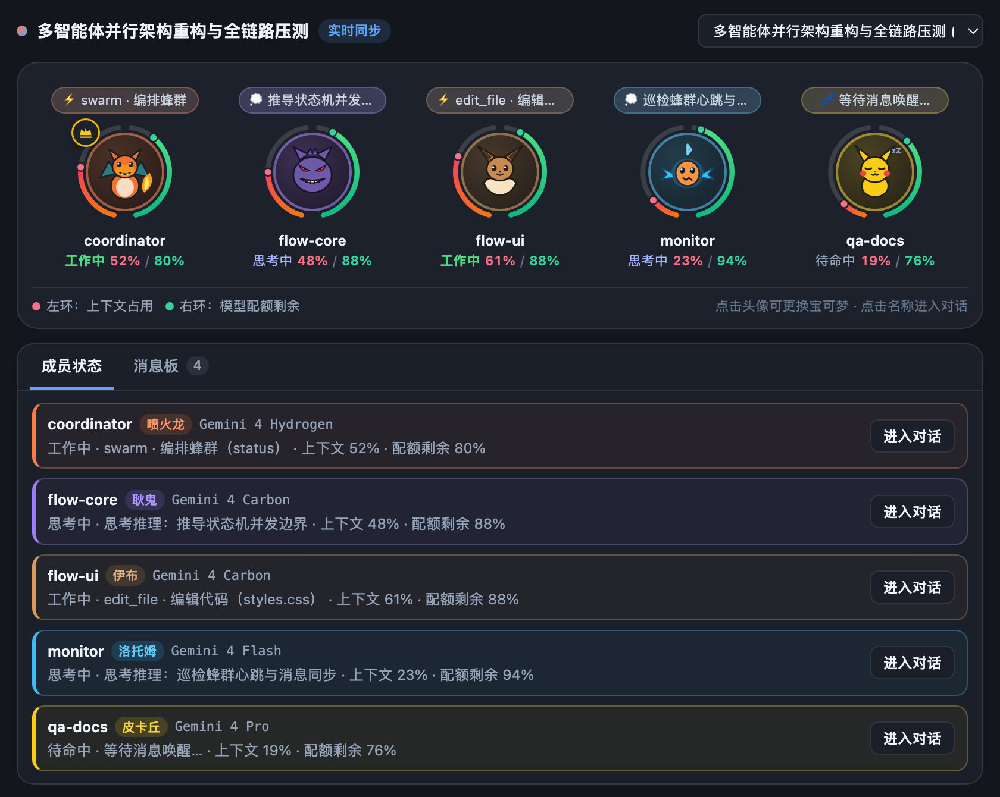
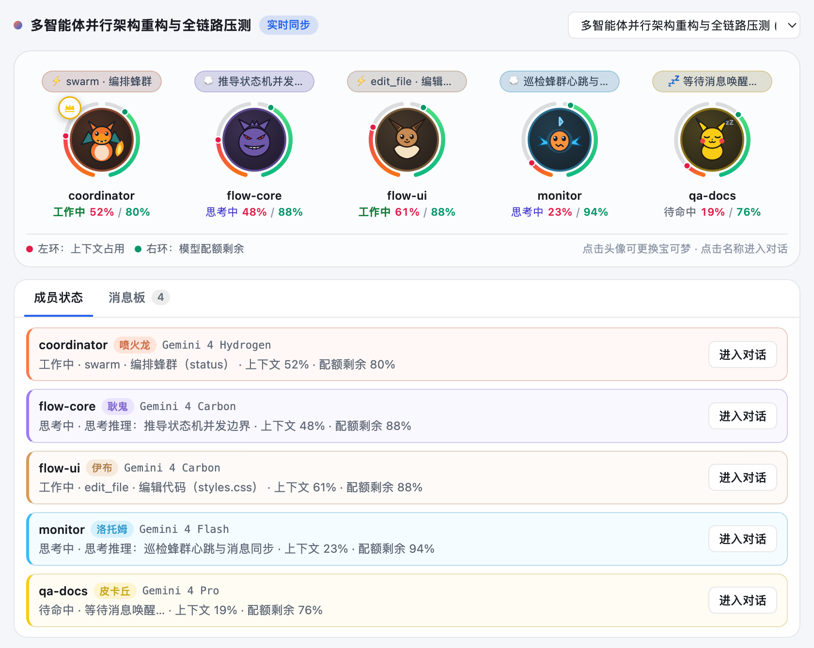
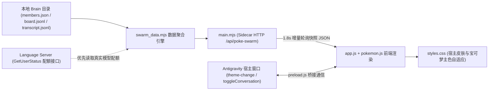

<div align="center">


# Poke Swarm HUD

**宝可梦风格的 Google Antigravity 蜂群（Swarm）实时监控看板插件**

[](README.md)
[](README.en.md)

[](LICENSE)
[](#安装与启用)
[](#技术栈与目录结构)
[](#本地开发与测试)

[界面预览](#界面预览) · [核心特性](#核心特性) · [指标与状态说明](#指标与状态说明) · [宝可梦匹配规则](#宝可梦角色自动匹配规则) · [安装与启用](#安装与启用) · [系统架构](#工作原理与架构) · [开发与测试](#本地开发与测试)

<br />

<picture>
  <source media="(prefers-color-scheme: dark)" srcset="assets/preview-dark.png" />
  <source media="(prefers-color-scheme: light)" srcset="assets/preview-light.png" />
  
</picture>

</div>

---

## 界面预览

看板支持自动感知宿主明暗主题与自定义皮肤配色，以下为深色与浅色模式下的 2x Retina 实景截图对比：

<table>
  <tr>
    <th width="50%">深色模式（Dark Mode）</th>
    <th width="50%">浅色模式（Light Mode 自动适配）</th>
  </tr>
  <tr>
    <td></td>
    <td></td>
  </tr>
</table>

---

## 核心特性

- **10 款纯内联矢量 SVG 宝可梦化身**
  所有宝可梦均采用高精度内联 SVG 绘制，离线零外部 CDN 依赖；支持点击任意头像弹出皮肤选择器自定义更换并持久化保存于本地存储，Coordinator 左上角自动佩戴金色皇冠徽章。

- **双色环形健康度指标**
  头像外围以双弧环形进度条同屏展示「上下文窗口占用」与「模型配额 / 同步进度」，无需切出当前对话即可一眼识别瓶颈成员。

- **毫秒级增量日志活动气泡**
  基于文件 `mtime/size` 缓存高效解析 `transcript.jsonl`，在头像上方以胶囊气泡展示当前工具调用语义（如 `swarm · 编排蜂群`、`edit_file · 编辑代码`）或最新思考推理摘要。

- **宿主主题与宝可梦主色双重自适应**
  - **宿主主题自适应**：实时监听 Antigravity 注入的 `theme-change` CSS 变量（`--background`、`--card`、`--secondary`、`--foreground`、`--primary` 等），结合真实背景亮度自动切换 `data-theme` 与 `color-scheme`。
  - **宝可梦主色联动**：成员卡片、悬停光晕、气泡边框及详情行左强调线均自动绑定当前宝可梦的 `--poke-accent` 主色，同时保持双色进度环的语义独立性。

- **单行紧凑胶囊与一键会话直达**
  保持单行紧凑横排，成员超出窗口宽度时隐藏底部滚动条，支持鼠标滚轮横向滑动与左右边缘柔和渐隐提示；点击成员名称或详情列表中的「进入对话」即可直达对应子智能体会话，右上角下拉框支持切换本机其它历史 Swarm。

---

## 指标与状态说明

### 1. 双色进度环数据来源

| 指标位置 | 默认色彩 | 含义说明 | 数据来源与回退策略 |
| :--- | :---: | :--- | :--- |
| **左环** | 橙红渐变 (`#f97316` → `#f43f5e`) | 上下文窗口占用率 | 读取成员最新 `PLANNER_RESPONSE` 中的 `input_tokens + cache_read_tokens + output_tokens`，按 `1M` 上下文窗口估算百分比 |
| **右环** | 翠绿渐变 (`#10b981` → `#4ade80`) | 模型剩余配额 / 同步率 | 优先调用本地 Language Server `GetUserStatus` 获取对应模型真实剩余配额；离线时自动回退为 `last_read_seq / head` 消息板同步率 |

### 2. 成员运行状态与宝可梦视觉反馈

| 状态 | 气泡图标 | 宝可梦视觉表现 | 判定条件 |
| :--- | :---: | :--- | :--- |
| **工作中** | `⚡` | 柔和上下悬浮微动效 | 最新轮次存在活跃的工具调用（非 `swarm_wait`） |
| **思考中** | `💭` | 悬浮微动效 + 气泡呼吸闪烁 | 正在推理或等待中间响应，暂无工具结束信号 |
| **待命中** | `💤` | 闭眼休息态 + 头像右上角 `zZ` | 已调用 `swarm_wait` 完成或回合结束等待唤醒 |
| **已结束** | `✓` | 头像灰阶降透明度显示 | `members.json` 标记 `killed: true` |
| **配额受限 / 异常** | `⚠` | 琥珀色警告标签高亮 | 最近一步出现 429 配额耗尽或静置报错 |

---

## 宝可梦角色自动匹配规则

系统按成员名称中的角色关键词自动指派最契合的宝可梦形象；未命中关键词时按名称稳定哈希分配其余角色（可随时点击头像手动切换）：

| 宝可梦 | 英文名 | 专属强调色 | 自动匹配成员命名关键词（正则） | 常见职责定位 |
| :--- | :--- | :---: | :--- | :--- |
| **喷火龙** | `Charizard` | `#ff7a45` | `coordinator` \| `lead` \| `master` \| `chief` \| `queen` | 总控协调者（佩戴金色皇冠） |
| **洛托姆** | `Rotom` | `#38bdf8` | `monitor` \| `watch` \| `guard` \| `health` | 心跳巡检与停滞监控 |
| **伊布** | `Eevee` | `#d89b56` | `ui` \| `front` \| `web` \| `css` \| `view` \| `design` | 前端页面、样式与交互设计 |
| **耿鬼** | `Gengar` | `#9d7aff` | `core` \| `back` \| `api` \| `server` \| `parser` \| `engine` \| `rust` \| `go` | 核心引擎、后端接口与解析器 |
| **皮卡丘** | `Pikachu` | `#facc15` | `doc` \| `readme` \| `test` \| `verify` \| `verifier` \| `qa` \| `check` | 测试验证、质量门禁与文档 |
| **妙蛙种子** | `Bulbasaur` | `#34d399` | `narrator` \| `summary` \| `overview` | 进度汇总与叙事解说 |
| **杰尼龟** | `Squirtle` | `#60a5fa` | `build` \| `infra` \| `cli` \| `script` \| `ops` \| `db` \| `sql` | 构建脚本、运维与数据库 |
| **路卡利欧** | `Lucario` | `#3b82f6` | `ml` \| `ai` \| `model` \| `data` | 模型推理与数据处理 |
| **胖丁** | `Jigglypuff` | `#f472b6` | 未命中以上规则时按名称哈希分配 / 弹窗手选 | 通用协作 Worker |
| **卡比兽** | `Snorlax` | `#5eead4` | 未命中以上规则时按名称哈希分配 / 弹窗手选 | 通用协作 Worker |

---

## 安装与启用

### 1. 克隆到 Antigravity 全局插件目录

```bash
git clone https://github.com/xialeizhou77/antigravity-poke-swarm.git ~/.gemini/config/plugins/poke-swarm
```

放入 `~/.gemini/config/plugins/poke-swarm` 后，Antigravity 会自动发现并全局启用该插件。

> [!TIP]
> 升级插件时只需进入 `~/.gemini/config/plugins/poke-swarm` 执行 `git pull`，然后在 **Customizations → Plugins** 页面将 `Poke Swarm HUD` 关闭后再重新开启，即可刷新 Sidecar 进程加载最新版本。

### 2. 打开看板的两种方式

1. **右侧辅助侧边栏（推荐）**：在 Antigravity 右侧辅助侧边栏（Aux Pane）顶部标签栏点击 `+`，直接选择 **Poke Swarm** 即可并列常驻显示。
2. **对话自然语言唤起**：在对话中输入「打开宝可梦蜂群看板」或「查看当前 Swarm 成员状态」，内置 `poke-swarm` 技能（Skill）会立即生成一键开启看板的快捷卡片。

---

## 工作原理与架构



---

## 技术栈与目录结构

本项目**零第三方 npm 运行时依赖**，全部代码基于 Node.js 原生 ESM、浏览器标准 Web API 与 Antigravity `sidecar_sdk` 构建：

```text
poke-swarm/
├── plugin.json                      # Antigravity 插件清单（图标、描述与推荐提示词）
├── README.md                        # 中文主文档
├── README.en.md                     # 英文镜像文档（支持与中文一键互切）
├── LICENSE                          # MIT 开源协议
├── .gitignore
├── assets/
│   ├── logo.svg                     # 插件矢量图标
│   ├── preview-dark.png             # 深色主题 2x Retina 实景图
│   └── preview-light.png            # 浅色主题 2x Retina 实景图
├── skills/
│   └── poke-swarm/
│       └── SKILL.md                 # 自然语言唤起 Poke Swarm 看板的技能定义
└── sidecars/
    └── poke_swarm/
        ├── sidecar.json             # Sidecar 进程与 Aux Pane 入口配置
        ├── package.json             # 包元数据与测试脚本入口
        ├── main.mjs                 # Sidecar HTTP 服务入口（含 CORS 与静态资源路由）
        ├── swarm_data.mjs           # Swarm 成员、消息板、增量日志与配额聚合模块
        ├── swarm_data.test.mjs      # 基于 node:test 的单元测试套件
        ├── pokemon.js               # 10 款宝可梦矢量 SVG 绘制与角色匹配引擎
        ├── index.html               # 看板 HTML 结构
        ├── styles.css               # 宿主主题自适应、双色环与单行边缘渐隐样式
        └── app.js                   # 前端轮询、主题同步、弹窗换肤与会话跳转逻辑
```

---

## 本地开发与测试

修改任意源码后，进入 Sidecar 目录运行单元测试与语法检查（覆盖 Swarm 状态聚合解析、宝可梦 SVG 渲染映射及皮肤自适应 CSS 变量断言）：

```bash
cd sidecars/poke_swarm
npm test
node --check main.mjs && node --check app.js && node --check pokemon.js && node --check swarm_data.mjs
```

---

## 开源协议

本项目基于 [MIT License](LICENSE) 开源，欢迎提交 Issue 与 Pull Request 扩展更多宝可梦角色皮肤或增强监控指标。
